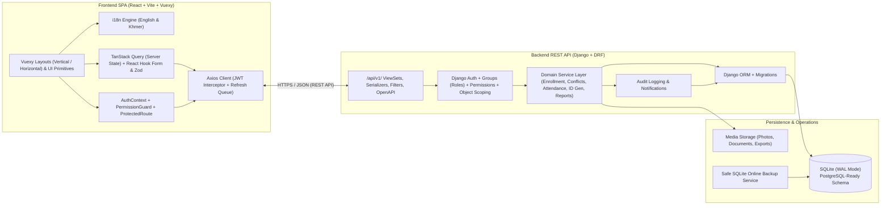

# Student Portal & Academic Management System — System Architecture

> **Document Status:** Proposed for Architecture Review (Phase 0)  
> **Project:** Student Portal & Academic Management System (SAMS)  
> **Stack:** Django + Django REST Framework + SQLite (PostgreSQL-ready) | React + Vite + Vuexy React Template  

---

## 1. Workspace Audit & Current State

An inspection of `/Users/kn/Documents/learning/student-portal` confirms this is a greenfield workspace:

| Check | Status | Details |
| :--- | :--- | :--- |
| **Project Skill** | Present | `.agent/skills/student-portal-development/SKILL.md` loaded and reviewed |
| **Backend Files** | Not present | No `backend/` directory, Django project, or Python virtual environment yet |
| **Frontend Files** | Not present | No `frontend/` directory or React/Vite project yet |
| **Vuexy React Template** | **Bootstrap 5 Vuexy-Styled Implementation** | Per user direction in Phase 1, the frontend uses React + Vite + TypeScript + Bootstrap 5 styled closely after the Vuexy template's design system (`src/styles/vuexy-theme.css`) |
| **Git Repository** | Not initialized | No `.git/` directory present yet (will be initialized in Phase 1) |
| **Local Toolchain (Default PATH)** | Needs verification | Default shell PATH reports `python3` 3.9.6; `node`, `npm`, `pnpm`, `yarn`, and `uv` were not found in default PATH |

> [!IMPORTANT]
> **Awaiting Vuexy React Template & Toolchain Confirmation:**  
> Before Phase 1 frontend setup begins, the Vuexy React template must be placed in `frontend/` (or provided for inspection), and Python 3.11+ (for Django 5.2 LTS) and Node.js 20+ LTS must be confirmed available in the development environment.

---

## 2. High-Level System Architecture

The system follows a strict **decoupled client–server architecture** with two independent applications sharing a versioned REST API contract (`/api/v1/`). All domain rules, validation, authorization, reporting aggregations, and audit logging live exclusively in the Django backend.



### Core Architectural Principles

1. **Backend as Single Source of Truth:** Business rules (enrollment eligibility, class capacity, schedule conflict detection, duplicate attendance prevention, student ID generation, GPA calculation) are enforced in backend services and database constraints — never duplicated in React.
2. **Modular Domain Boundaries:** Each academic domain is encapsulated in a dedicated Django app with thin views, strict serializers, explicit permission classes, and focused service modules.
3. **Template-First Frontend Integration:** Vuexy React's layout system, theme engine, navigation architecture, and UI primitives are reused directly rather than rebuilt.
4. **Historical Immutability:** Academic records (`Student`, `Enrollment`, `ClassMembership`, `AttendanceRecord`, `SubjectGrade`) are preserved over time using soft deletion and `PROTECT` foreign keys.
5. **Extensibility by Design:** Future modules (tuition/finance, scholarships, online student requests, mobile clients) can consume the same `/api/v1/` API and link to `Student`, `Enrollment`, and `AcademicYear` without schema redesign.

---

## 3. Repository & Directory Structure

```text
student-portal/
├── .agent/                      # Project skills and agent conventions
├── docs/                        # Architecture, database design, roadmap, runbooks
│   ├── architecture.md
│   ├── database-design.md
│   └── development-roadmap.md
├── backend/                     # Django + DRF REST API
├── frontend/                    # React + Vite + Vuexy SPA
├── .gitignore
└── README.md
```

---

## 4. Proposed Django Backend Structure

The backend places configuration under `config/` and modular domain applications under `apps/` so the repository remains clean as the system scales across all 12+ modules.

```text
backend/
├── manage.py
├── pyproject.toml               # Dependencies, ruff/pytest configuration (or requirements/)
├── .env.example                 # Environment variable template (never commit .env)
├── config/
│   ├── __init__.py
│   ├── asgi.py
│   ├── wsgi.py
│   ├── urls.py                  # Mounts /api/v1/, /api/schema/, /api/docs/, /admin/
│   └── settings/
│       ├── __init__.py
│       ├── base.py              # Shared settings (DRF, SimpleJWT, CORS, logging, media)
│       ├── dev.py               # DEBUG=True, SQLite WAL, browsable API
│       ├── test.py              # Fast test runner settings
│       └── prod.py              # DEBUG=False, HTTPS security headers, PostgreSQL-ready
├── apps/
│   ├── __init__.py
│   ├── core/                    # Shared infrastructure (no domain coupling)
│   │   ├── models.py            # TimeStampedModel, SoftDeleteModel, BaseAuditModel
│   │   ├── pagination.py        # StandardPageNumberPagination (configurable page size)
│   │   ├── exceptions.py        # Consistent API error envelope handler
│   │   ├── permissions.py       # Base DjangoModelPermissions + object-scope helpers
│   │   ├── validators.py        # Safe file upload (MIME/extension/size), phone, Khmer text
│   │   └── management/
│   ├── accounts/                # Auth, Users, Django Groups (Roles), Permissions, Preferences
│   ├── academics/               # AcademicYear, Semester, Degree, Major, YearLevel
│   ├── subjects/                # Subject, Curriculum, CurriculumSubject
│   ├── students/                # Student, Guardians, Contacts, EducationHistory, Documents, ID Gen
│   ├── enrollments/             # Enrollment, Promotion, Re-enrollment, Major/Degree Change, History
│   ├── classes/                 # Classroom, ClassSection, ClassSubject, ClassMembership, Transfers
│   ├── teachers/                # Teacher, TeachingAssignment, ClassSchedule, Conflict Detection
│   ├── attendance/              # AttendanceSession, AttendanceRecord, Bulk Marking, Warnings
│   ├── examinations/            # AssessmentType, Assessment, StudentScore, GradingScale, Grades/GPA
│   ├── reports/                 # Dashboard KPIs, Filtered Reports, CSV/Excel/PDF Exports
│   ├── notifications/           # In-app Notifications & Alert Dispatching
│   ├── system_settings/         # Institution Config, Student ID Format, Safe SQLite Backups
│   └── auditlogs/               # Append-only AuditLog model, writer service, read-only API
├── media/                       # Uploaded photos, student documents (gitignored)
└── backups/                     # Local database backups (gitignored, configurable path)
```

> [!NOTE]
> The settings app is intentionally named `apps.system_settings` instead of `apps.settings` to prevent Python import collisions with `django.conf.settings`.

### Standard Internal Module Layout

Every domain app under `backend/apps/<module>/` follows a consistent, predictable structure:

```text
apps/<module>/
├── __init__.py
├── apps.py
├── admin.py
├── models.py          # Or models/ subpackage if > 400 lines
├── serializers.py     # Separate Read/List/Detail/Write serializers to avoid over-exposure
├── views.py           # Thin DRF ViewSets delegating complex logic to services.py
├── urls.py            # DRF Router registration for /api/v1/<resource>/
├── permissions.py     # Module-specific permissions & object-level scoping
├── filters.py         # django-filter FilterSets for advanced filtering
├── services.py        # Transactional business workflows (atomic operations, audit hooks)
├── selectors.py       # Complex read queries (select_related / prefetch_related optimizations)
└── tests/
    ├── test_models.py
    ├── test_services.py
    ├── test_api.py
    └── test_permissions.py
```

---

## 5. Proposed React Frontend Architecture & Vuexy Integration

### 5.1 Vuexy Template Integration Strategy

Because Vuexy React files are not yet in the workspace, we define a **non-invasive integration boundary** so that once the template is placed in `frontend/`, we inspect it first and plug into its native capabilities without rewriting it.

#### Mandatory Pre-Integration Inspection Checklist (Start of Phase 1)
Once Vuexy is added to `frontend/`, we will inspect:
1. `package.json` — React version, Vite config, UI library variant (**MUI** vs **Reactstrap/Bootstrap**), TypeScript vs JavaScript, pre-installed libraries (Axios, i18next, ApexCharts, React Router, CASL).
2. Layout engine (`@core/layouts` or `src/@layouts`) — exact props and context controlling **Vertical** vs **Horizontal** layout switching and **Light/Dark** mode.
3. Navigation system — how vertical sidebar items and horizontal navbar items consume menu configs and visibility checks.
4. Auth & ACL hooks — whether Vuexy ships CASL (`@casl/react`) or a custom guard, so we adapt our permission strings (`app_label.codename`) cleanly into it.
5. Theme & typography overrides — how to register Khmer Unicode fonts (`Noto Sans Khmer` / `Kantumruy Pro`) cleanly alongside Vuexy's Latin font stack.

#### What Is Currently Waiting for the Vuexy Template
- The Vuexy React (Vite) starter-kit or full-version source files placed in `frontend/`.
- Confirmation of which Vuexy React flavor is being used (Vite + Reactstrap/Bootstrap vs Vite + MUI, TypeScript vs JavaScript).

### 5.2 Proposed Frontend Folder Structure

```text
frontend/
├── index.html
├── vite.config.ts
├── tsconfig.json                # Prefer TypeScript for all new portal modules
├── .env.example                 # VITE_API_BASE_URL=/api/v1
└── src/
    ├── @core/                   # [VUEXY CORE] Kept intact — layouts, theme, base components
    ├── assets/                  # [VUEXY + PORTAL] Styles, Khmer font imports, institution assets
    ├── configs/
    │   ├── themeConfig.ts       # Vuexy default theme, layout (vertical/horizontal), skin (light/dark)
    │   ├── env.ts               # Typed environment variables
    │   └── constants.ts         # Pagination defaults, date formats, status enums
    ├── i18n/
    │   ├── index.ts             # i18next setup, language persistence, HTML lang="en|km" sync
    │   └── locales/
    │       ├── en/              # Modular namespaces: common, auth, academics, students, attendance...
    │       └── km/              # Full Khmer translations mirroring en/ keys 1:1
    ├── api/
    │   ├── client.ts            # Axios instance, auth header injection, 401 refresh queue, error normalization
    │   ├── queryClient.ts       # TanStack Query default cache, retry, and error handling config
    │   └── types.ts             # Shared PaginatedResponse<T>, ApiError, QueryParams
    ├── auth/
    │   ├── AuthContext.tsx      # Authenticated user, permissions Set, login/logout, preference sync
    │   ├── useAuth.ts
    │   ├── usePermission.ts     # hasPermission(perm), hasAnyPermission([...]), hasAllPermissions([...])
    │   ├── PermissionGuard.tsx  # Conditional UI rendering wrapper
    │   └── ProtectedRoute.tsx   # Route-level auth + permission enforcement -> /login or /forbidden
    ├── layouts/
    │   ├── PortalLayout.tsx     # Wraps Vuexy Vertical/Horizontal layouts, syncs layout switcher
    │   └── components/          # Custom Navbar items (Language switcher, Layout toggle, Notifications, User menu)
    ├── navigation/
    │   ├── menuConfig.ts        # Single source of truth for menu items + required permission + i18n key
    │   ├── vertical.ts          # Adapter projecting filtered menuConfig to Vuexy VerticalNav
    │   └── horizontal.ts        # Adapter projecting filtered menuConfig to Vuexy HorizontalNav
    ├── components/              # Reusable SAMS UI primitives built on top of Vuexy components
    │   ├── PageHeader.tsx       # Title, breadcrumbs, primary action buttons
    │   ├── DataTable.tsx        # Server-side pagination, sorting, search, column visibility, skeletons
    │   ├── FilterBar.tsx        # Cascading academic filters (Year -> Degree -> Major -> Class)
    │   ├── FormModal.tsx        # Consistent modal/drawer form wrapper
    │   ├── ConfirmDialog.tsx    # Destructive/archive confirmation dialog
    │   ├── StatusBadge.tsx      # Consistent color-coded translated status pills
    │   ├── EmptyState.tsx
    │   ├── ErrorState.tsx
    │   └── PrintContainer.tsx   # Print-friendly layout wrapper
    ├── features/                # Domain feature modules (each self-contained)
    │   ├── auth/                # Login, Change Password, Unauthorized (401), Forbidden (403)
    │   ├── dashboard/           # Role-scoped dynamic dashboards (Admin, Academic Officer, Instructor, Student)
    │   ├── users/               # Users, Roles (Groups), Permissions matrix
    │   ├── academics/           # Academic Years, Semesters, Degrees, Majors, Year Levels, Subjects, Curriculum
    │   ├── students/            # Registration wizard, List, Detail tabs, Documents, Print Profile
    │   ├── enrollments/         # Enroll, Re-enroll, Promote, Transfer, History
    │   ├── classes/             # List, Detail (Overview/Students/Subjects/Teachers/Schedule/Attendance/Reports)
    │   ├── teachers/            # Teacher profiles, Teaching assignments, Weekly schedule grid
    │   ├── attendance/          # Cascading selector -> Bulk attendance sheet, History, Corrections, Warnings
    │   ├── examinations/        # Assessments, Score entry grid, Grades, Transcripts
    │   ├── reports/             # Filterable reports + CSV/Excel/PDF/Print triggers
    │   ├── notifications/       # Notification center & read-state management
    │   └── settings/            # Institution config, Student ID format, Backup management, Audit Logs
    └── router/
        ├── index.tsx            # Lazy-loaded routes with permission metadata
        └── routes/              # Modular route definitions per feature
```

### 5.3 Layout, Theme & Bilingual (EN/KM) Strategy

- **Vertical & Horizontal Layouts:** A single `menuConfig.ts` defines all navigation items with `i18nKey` and `permission`. Both Vuexy layout adapters consume the exact same permission-filtered tree, ensuring parity between layouts. Users can toggle Vertical/Horizontal layout and Light/Dark theme from the navbar/customizer; changes persist locally and sync to `PATCH /api/v1/auth/me/preferences/`.
- **English & Khmer Localization:**
  - Centralized `i18next` with modular JSON namespaces (`en/`, `km/`). Zero hardcoded UI strings.
  - Switching language updates `document.documentElement.lang` (`en` or `km`) and applies a Khmer-optimized font stack (`Noto Sans Khmer` / `Kantumruy Pro`) with adjusted line-height (`1.6–1.75`) so Khmer vowel/subscript stacking renders cleanly without clipping.
  - Language switching happens in-memory without page reload, preserving current route, table filters, and active form inputs.
  - Domain entities that require bilingual display (e.g., `Student.full_name_en` / `full_name_km`, `Degree`, `Major`, `Subject`) store both scripts in the database so reports and official transcripts render accurately in either language.

---

## 6. Authentication & Permission Architecture

### 6.1 Authentication Flow

The backend uses Django's native authentication system (`django.contrib.auth`), extended cleanly with a custom `accounts.User(AbstractUser)` model configured as `AUTH_USER_MODEL` before the initial migration. This preserves 100% compatibility with Django's `Group`, `Permission`, and Admin frameworks while allowing safe future user attributes (`phone`, `must_change_password`, `preferred_language`, `preferred_layout`, `preferred_theme`).

- **Token Mechanism:** `djangorestframework-simplejwt` with:
  - Short-lived **Access Token** (15 minutes) sent via `Authorization: Bearer <token>`.
  - Rotating **Refresh Token** (7 days) stored in an **`HttpOnly`, `SameSite=Lax`, `Secure` (prod) cookie** to mitigate XSS token theft, with server-side token blacklisting on logout and password change.
  - Axios interceptor automatically queues concurrent `401` requests, executes a single refresh call, and replays queued requests; on refresh failure, clears state and redirects to `/login`.
- **Auth Endpoints (`/api/v1/auth/`):**
  - `POST /api/v1/auth/login/` — Authenticate credentials, return user summary + access token (and set HttpOnly refresh cookie).
  - `POST /api/v1/auth/logout/` — Blacklist refresh token and clear cookie.
  - `POST /api/v1/auth/token/refresh/` — Rotate refresh token and issue a fresh access token.
  - `GET /api/v1/auth/me/` — Current user profile, assigned groups, and UI preferences.
  - `PATCH /api/v1/auth/me/preferences/` — Update language, layout, and theme preferences.
  - `GET /api/v1/auth/me/permissions/` — Effective flat list of Django permission codenames (`["students.view_student", ...]`).
  - `POST /api/v1/auth/password/change/` — Verify current password, apply Django password validators, update password, and revoke existing refresh tokens.

### 6.2 Role & Permission Model (Django Groups + Permissions)

- **Roles = Django `Group` instances.** No duplicate custom role table is created.
- **Capabilities = Django `Permission` instances** (`add_*`, `change_*`, `delete_*`, `view_*`) supplemented by explicit **custom `Meta.permissions`** on domain models where actions exceed basic CRUD:
  - `students.archive_student`, `students.export_student`, `students.print_student_profile`
  - `enrollments.promote_enrollment`, `enrollments.transfer_enrollment`
  - `classes.assign_class_student`, `classes.transfer_class_student`
  - `attendance.take_attendance`, `attendance.correct_attendance`, `attendance.export_attendance`
  - `examinations.publish_grades`, `examinations.override_grade`
  - `reports.view_admin_dashboard`, `reports.view_academic_dashboard`, `reports.view_instructor_dashboard`, `reports.view_student_dashboard`, `reports.export_reports`
  - `system_settings.manage_system_settings`, `system_settings.manage_backups`
  - `auditlogs.view_audit_logs`
- An idempotent management command (`python manage.py seed_roles_permissions`) seeds the default 10 Groups and their baseline permissions, while System/Super Administrators can fine-tune group permissions at runtime via the Role Management UI.

### 6.3 Role Permission Matrix (Baseline)

| Role (Django Group) | Users & Roles | Academics & Curriculum | Students | Enrollments | Classes & Schedules | Teachers | Attendance | Exams & Grades | Reports & Exports | Settings, Backups & Audit |
| :--- | :---: | :---: | :---: | :---: | :---: | :---: | :---: | :---: | :---: | :---: |
| **Super Administrator** | Full | Full | Full | Full | Full | Full | Full | Full | Full | Full |
| **System Administrator** | Manage Users/Groups | View | View | View | View | View | View | View | View/Export | Settings, Backups, Audit |
| **Academic Administrator** | View | Full | Full | Full | Full | Full | View/Correct | Full | Full | View |
| **Registrar** | — | View | Full + Export | Full + Promote | Assign/Transfer | View | View | View Transcripts | Student/Enroll Reports | — |
| **Academic Officer** | — | Manage Semesters/Curriculum | View/Create/Edit | Manage | Full | Assign/Schedule | View | Manage | Academic Reports | — |
| **Department Head** | — | View/Edit Dept Curriculum | View (Dept) | View (Dept) | View/Manage (Dept) | View/Assign (Dept) | View (Dept) | Review/Approve (Dept) | Dept Reports | — |
| **Instructor** | — | View Assigned | View (Own Classes) | — | View (Own Classes) | View Self | Take/Edit (Own Classes) | Enter Scores (Own Classes) | Own Class Reports | — |
| **Attendance Officer** | — | View | View | View | View | View | Take/Edit/Correct/Export | — | Attendance Reports | — |
| **Student Affairs** | — | View | View/Edit Notes & Docs | View | View | — | View/Warnings | — | Status & Warning Reports | — |
| **Student** | Self Profile | View Curriculum | Self Only | Self Only | Self Schedule/Class | — | Self Summary | Self Grades | Self Transcript | — |

### 6.4 Two-Layer Authorization Enforcement

1. **Action-Level (Endpoint) Permission:** Every DRF ViewSet inherits a custom `StrictDjangoModelPermissions` (which, unlike DRF's default, **also enforces `view_*` on `GET` requests**) plus action-specific permission classes for custom endpoints (`@action`).
2. **Object/Row-Level Scoping:** Querysets in `selectors.py` / `get_queryset()` automatically scope records to the authenticated user's authority:
   - **Instructor** sees only `ClassSection`, `Student`, `AttendanceSession`, and `Assessment` rows linked to their active `TeachingAssignment`.
   - **Student** sees only records where `student.user == request.user`.
   - **Department Head** (when linked to specific majors/departments) is scoped to those programs.
   - Any attempt to access an out-of-scope ID returns `403 Forbidden` or `404 Not Found` (preventing IDOR enumeration).

---

## 7. API Architecture & Standards

- **Base URL:** `/api/v1/`
- **Documentation:** Auto-generated OpenAPI 3.0 schema via `drf-spectacular` (`/api/schema/`, `/api/docs/`).
- **Resource Endpoints:**
  - `/api/v1/auth/` — Authentication, current user, preferences, permissions, password change
  - `/api/v1/users/`, `/api/v1/roles/`, `/api/v1/permissions/` — User & RBAC administration
  - `/api/v1/academic-years/`, `/api/v1/semesters/`, `/api/v1/degrees/`, `/api/v1/majors/`, `/api/v1/year-levels/`
  - `/api/v1/subjects/`, `/api/v1/curricula/`
  - `/api/v1/students/` (+ nested `/documents/`, `/guardians/`, `/education-history/`, `/status-history/`, `/print-data/`)
  - `/api/v1/enrollments/` (+ actions: `promote/`, `re-enroll/`, `transfer/`)
  - `/api/v1/classrooms/`, `/api/v1/classes/` (+ nested `/students/`, `/subjects/`, `/teachers/`, `/schedule/`, `/attendance/`, `/transfer-student/`)
  - `/api/v1/teachers/`, `/api/v1/teaching-assignments/`, `/api/v1/schedules/` (+ `check-conflicts/`)
  - `/api/v1/attendance/sessions/`, `/api/v1/attendance/records/`, `/api/v1/attendance/bulk-mark/`, `/api/v1/attendance/warnings/`
  - `/api/v1/assessments/`, `/api/v1/scores/`, `/api/v1/grades/`
  - `/api/v1/dashboard/` (admin, academic-officer, instructor, student)
  - `/api/v1/reports/` (student-list, enrollment-summary, attendance-monthly, academic-progress + `?export=csv|xlsx|pdf`)
  - `/api/v1/notifications/`
  - `/api/v1/settings/`, `/api/v1/backups/`
  - `/api/v1/audit-logs/`

### Consistent Response & Error Envelopes

**Paginated List Response:**
```json
{
  "count": 142,
  "page": 1,
  "page_size": 20,
  "total_pages": 8,
  "next": "/api/v1/students/?page=2",
  "previous": null,
  "results": []
}
```

**Normalized Error Response:**
```json
{
  "error": {
    "code": "validation_error",
    "message": "One or more fields failed validation.",
    "details": {
      "student_code": ["A student with this code already exists."]
    }
  }
}
```

---

## 8. Cross-Cutting Concerns

### 8.1 Audit Logging
- All sensitive and academic state transitions (student creation/update/status change, enrollment/promotion/transfer, class assignment/transfer, attendance creation/correction, user/role/permission changes, academic configuration updates, settings/backup triggers) emit structured entries to `auditlogs.AuditLog`.
- Logs capture: `actor` (User FK, `SET_NULL`), `action`, `module`, `object_type`, `object_id`, `object_repr`, `changes` (sanitized before/after diff JSON), `ip_address`, `user_agent`, `created_at`.
- Sensitive fields (`password`, tokens, secret keys) are stripped by a centralized sanitizer before persistence.

### 8.2 File Uploads & Media Security
- Allowed extensions and MIME types validated server-side (e.g., `jpg/jpeg/png/webp` for profile photos; `pdf/jpg/png` for student documents) with configurable max file size from `SystemSetting`.
- Uploaded filenames are replaced with UUID-based safe paths under `media/students/<student_uuid>/...` to prevent path traversal and filename leaks.
- Sensitive student documents are served through permission-checked download endpoints (not unauthenticated open directory listing in production).

### 8.3 Safe SQLite Backup Strategy
- Raw file copying of an active SQLite database risks corruption during writes.
- Backups use Python's `sqlite3.Connection.backup()` API inside a dedicated management command (`python manage.py backup_database`) and admin API endpoint.
- Backup metadata (filename, size, checksum SHA-256, status, triggered_by, timestamp) is recorded in `system_settings.BackupRecord`.
- Retention policy and destination directory are configurable via `SystemSetting` / environment variables; scheduled backups run via cron or systemd timer invoking the management command.

---

## 9. Technical Risks & Architectural Assumptions

| # | Risk / Area | Impact | Mitigation |
| :--- | :--- | :--- | :--- |
| 1 | **Vuexy React Template Variant Unknown** | High — determines MUI vs Reactstrap components, TS vs JS, and layout APIs | Inspect template first in Phase 1 before writing any UI code; keep domain logic decoupled in `features/` and `api/` |
| 2 | **Local Environment Toolchain** | High — Python 3.9.6 cannot run Django 5.2 LTS (requires 3.10+); Node not in default PATH | Verify/install Python 3.11+ (with `venv`) and Node.js 20+ LTS before Phase 1 initialization |
| 3 | **SQLite Write Concurrency** | Medium — concurrent bulk attendance or registrations could hit `database is locked` | Enable SQLite WAL mode + `busy_timeout=5000`, keep transactions short, use bulk_create/bulk_update, maintain PostgreSQL-ready schema |
| 4 | **Khmer Unicode PDF Generation** | Medium — many PDF libraries break Khmer ligatures/subscripts | Use HTML-to-PDF (`WeasyPrint` with HarfBuzz/Pango + bundled `Noto Sans Khmer`) or browser print-optimized views; avoid ReportLab for Khmer |
| 5 | **Scope Complexity (12 Phases)** | Medium — building too fast causes broken integrations or untested permission holes | Enforce strict phase-by-phase delivery with automated API + permission tests passing before advancing |
| 6 | **Role vs Permission Drift** | Medium — hardcoding role names in React breaks runtime permission changes | Enforce permission codename checks exclusively on both DRF endpoints and React UI |

### Key Architectural Assumptions (To Confirm During Review)

1. **Custom `User(AbstractUser)`:** We assume initializing `accounts.User` inheriting `AbstractUser` (while strictly using Django's built-in `Group` and `Permission`) is preferred over raw `auth.User` to prevent painful migrations later.
2. **Primary Enrollment Cadence:** We assume a student has at most one **active** enrollment per `(AcademicYear, Degree, Major)` (or per `AcademicYear` + `Semester` when semester-based enrollment is enabled), configurable via business validation.
3. **Attendance Sessions:** We assume a class may have multiple attendance sessions for the same subject on the same date (e.g., morning and afternoon periods), uniquely keyed by `(class_section, subject, session_date, session_slot)`.
4. **Future Multi-Campus / Department Scoping:** We include optional `Department` readiness or clean Major-level grouping so Department Head scoping works cleanly without over-engineering Phase 1.
