# Student Portal & Academic Management System — Database Design

> **Document Status:** Proposed for Architecture Review (Phase 0)  
> **Initial Engine:** SQLite 3 (WAL mode, `foreign_keys=ON`)  
> **Target Migration Engine:** PostgreSQL 16+ (100% ORM-compatible schema)  

---

## 1. Database Design Principles

1. **Django ORM as Sole Schema Authority:** All schema definitions and changes are managed strictly through Django migrations (`makemigrations` / `migrate`). No manual DDL edits.
2. **PostgreSQL Migration Readiness:**
   - Use standard Django field types (`BigAutoField`, `UUIDField`, `DecimalField`, `DateField`, `DateTimeField`, `JSONField`).
   - Avoid SQLite-only pragmas or raw SQL queries in application code.
   - Define explicit `UniqueConstraint`, `CheckConstraint`, and `Index` declarations in `Meta`.
   - Use timezone-aware `DateTimeField` (`USE_TZ = True`, stored in UTC).
3. **Permanent Identity vs. Temporal Academic Records:**
   - `Student` represents a person's permanent identity across their entire institutional lifecycle.
   - `Enrollment` captures academic registration for a specific `AcademicYear` (and `Semester` where applicable), `Degree`, `Major`, and `YearLevel`.
   - `ClassMembership` links an `Enrollment` to a `ClassSection`.
   - Promoting a student to Year 2 creates a new `Enrollment` record — **never** a duplicate `Student` record.
4. **Historical Preservation & Non-Destructive Operations:**
   - Core academic entities inherit `SoftDeleteModel` (`is_deleted`, `deleted_at`, `deleted_by`) and use `on_delete=models.PROTECT` on historical foreign keys so deleting a parent record cannot cascade-destroy enrollments, attendance, or grades.
5. **Bilingual Data Support:**
   - Official academic entities (`Student`, `Degree`, `Major`, `Subject`) store both English and Khmer names (`_en`, `_km`) so bilingual UI, reports, and transcripts are accurate.

---

## 2. Core Entity-Relationship Diagram (ERD)

```mermaid
erDiagram
    USER ||--o| STUDENT : "optional portal login"
    USER ||--o| TEACHER : "optional staff login"
    USER }o--o{ AUTH_GROUP : "assigned roles"
    AUTH_GROUP }o--o{ AUTH_PERMISSION : "role permissions"

    ACADEMIC_YEAR ||--o{ SEMESTER : "contains"
    DEGREE ||--o{ MAJOR : "offers"
    DEGREE ||--o{ CURRICULUM : "defines"
    MAJOR ||--o{ CURRICULUM : "specializes"
    CURRICULUM ||--o{ CURRICULUM_SUBJECT : "includes"
    SUBJECT ||--o{ CURRICULUM_SUBJECT : "mapped in"
    YEAR_LEVEL ||--o{ CURRICULUM_SUBJECT : "scheduled for"

    STUDENT ||--o{ STUDENT_GUARDIAN : "has"
    STUDENT ||--o{ STUDENT_EDUCATION_HISTORY : "prior education"
    STUDENT ||--o{ STUDENT_DOCUMENT : "uploads"
    STUDENT ||--o{ STUDENT_STATUS_HISTORY : "status transitions"
    STUDENT ||--o{ ENROLLMENT : "enrolls in"

    ACADEMIC_YEAR ||--o{ ENROLLMENT : "academic period"
    SEMESTER |o--o{ ENROLLMENT : "optional term"
    DEGREE ||--o{ ENROLLMENT : "program degree"
    MAJOR ||--o{ ENROLLMENT : "program major"
    YEAR_LEVEL ||--o{ ENROLLMENT : "year level"
    ENROLLMENT ||--o{ ENROLLMENT_HISTORY : "tracks changes"

    ACADEMIC_YEAR ||--o{ CLASS_SECTION : "runs in"
    SEMESTER ||--o{ CLASS_SECTION : "term"
    DEGREE ||--o{ CLASS_SECTION : "for degree"
    MAJOR ||--o{ CLASS_SECTION : "for major"
    YEAR_LEVEL ||--o{ CLASS_SECTION : "for year"
    CLASSROOM |o--o{ CLASS_SECTION : "default room"
    TEACHER |o--o{ CLASS_SECTION : "homeroom advisor"

    ENROLLMENT ||--o{ CLASS_MEMBERSHIP : "assigned to"
    CLASS_SECTION ||--o{ CLASS_MEMBERSHIP : "roster"
    CLASS_MEMBERSHIP ||--o{ CLASS_TRANSFER_HISTORY : "transfers"

    CLASS_SECTION ||--o{ CLASS_SUBJECT : "offers"
    SUBJECT ||--o{ CLASS_SUBJECT : "taught in"
    TEACHER ||--o{ TEACHING_ASSIGNMENT : "assigned"
    CLASS_SECTION ||--o{ TEACHING_ASSIGNMENT : "class"
    SUBJECT ||--o{ TEACHING_ASSIGNMENT : "subject"
    SEMESTER ||--o{ TEACHING_ASSIGNMENT : "term"

    TEACHING_ASSIGNMENT ||--o{ CLASS_SCHEDULE : "scheduled slots"
    CLASSROOM ||--o{ CLASS_SCHEDULE : "room booking"

    CLASS_SECTION ||--o{ ATTENDANCE_SESSION : "holds"
    SUBJECT ||--o{ ATTENDANCE_SESSION : "for subject"
    TEACHER |o--o{ ATTENDANCE_SESSION : "conducted by"
    ATTENDANCE_SESSION ||--o{ ATTENDANCE_RECORD : "records"
    STUDENT ||--o{ ATTENDANCE_RECORD : "attendance of"
    ATTENDANCE_RECORD ||--o{ ATTENDANCE_CORRECTION_LOG : "corrections"

    CLASS_SECTION ||--o{ ASSESSMENT : "evaluated in"
    SUBJECT ||--o{ ASSESSMENT : "subject"
    ASSESSMENT_TYPE ||--o{ ASSESSMENT : "category"
    ASSESSMENT ||--o{ STUDENT_SCORE : "scores"
    ENROLLMENT ||--o{ STUDENT_SCORE : "student term"
    ENROLLMENT ||--o{ SUBJECT_GRADE : "final subject grade"
    SUBJECT ||--o{ SUBJECT_GRADE : "graded subject"

    USER ||--o{ NOTIFICATION : "receives"
    USER |o--o{ AUDIT_LOG : "performed by"
    USER |o--o{ BACKUP_RECORD : "triggered by"
```

---

## 3. Shared Base Models (`apps.core`)

| Abstract Base | Fields | Purpose |
| :--- | :--- | :--- |
| `TimeStampedModel` | `created_at` (DateTime, auto_now_add, indexed), `updated_at` (DateTime, auto_now) | Standard lifecycle timestamps |
| `SoftDeleteModel` | `is_deleted` (Bool, default=False, indexed), `deleted_at` (DateTime, null), `deleted_by` (FK User, null, SET_NULL) | Preserves historical records; default manager excludes deleted rows; `all_objects` manager includes archived rows |
| `BlameableModel` | `created_by` (FK User, null, SET_NULL), `updated_by` (FK User, null, SET_NULL) | Tracks creator/editor on administrative entities |

---

## 4. Detailed Schema by Domain

### 4.1 Accounts & RBAC (`apps.accounts` + `django.contrib.auth`)

#### `accounts_user` (`User(AbstractUser)`)
Extends Django's built-in `AbstractUser` (preserving `auth_group`, `auth_permission`, `accounts_user_groups`, `accounts_user_user_permissions`).

| Column | Type | Constraints / Notes |
| :--- | :--- | :--- |
| `id` | BigAutoField (PK) | |
| `username` | CharField(150) | Unique, indexed |
| `email` | EmailField | Unique (case-insensitive validation), indexed |
| `first_name`, `last_name` | CharField(150) | Standard Django fields |
| `full_name_km` | CharField(255) | Blank allowed |
| `phone` | CharField(30) | Blank allowed |
| `avatar` | ImageField | Null/blank, validated upload |
| `preferred_language` | CharField(5) | Choices: `en`, `km`; default `en` |
| `preferred_layout` | CharField(15) | Choices: `vertical`, `horizontal`; default `vertical` |
| `preferred_theme` | CharField(10) | Choices: `light`, `dark`, `system`; default `light` |
| `must_change_password` | BooleanField | Default `False` (useful for newly provisioned student/staff accounts) |
| `is_active`, `is_staff`, `is_superuser`, `last_login`, `date_joined` | Standard | Inherited from `AbstractUser` |

---

### 4.2 Academic Configuration (`apps.academics` & `apps.subjects`)

#### `academics_academic_year` (`AcademicYear`)
| Column | Type | Constraints / Notes |
| :--- | :--- | :--- |
| `id` | BigAutoField (PK) | |
| `name` | CharField(50) | Unique (e.g., `2025-2026`) |
| `start_date` | DateField | Required |
| `end_date` | DateField | Check: `end_date > start_date` |
| `status` | CharField(20) | Choices: `planned`, `active`, `completed`, `archived` |
| `is_current` | BooleanField | Default `False`; **Partial UniqueConstraint** where `is_current=True` (enforces single current academic year) |
| `description` | TextField | Blank allowed |

#### `academics_semester` (`Semester`)
| Column | Type | Constraints / Notes |
| :--- | :--- | :--- |
| `id` | BigAutoField (PK) | |
| `academic_year_id` | FK(`AcademicYear`) | `PROTECT`, indexed |
| `name` | CharField(50) | e.g., `Semester 1`, `Semester 2` |
| `code` | CharField(20) | e.g., `S1`, `S2` |
| `sequence_number` | PositiveSmallIntegerField | Ordering within academic year |
| `start_date`, `end_date` | DateField | Check: `end_date > start_date`; service validates within parent AcademicYear bounds |
| `is_current` | BooleanField | Default `False`; partial unique where `is_current=True` |
| `status` | CharField(20) | `planned`, `active`, `completed` |
| **Constraints** | | Unique `(academic_year, code)` and `(academic_year, sequence_number)` |

#### `academics_degree` (`Degree`)
| Column | Type | Constraints / Notes |
| :--- | :--- | :--- |
| `id` | BigAutoField (PK) | |
| `code` | CharField(20) | Unique (e.g., `HD`, `BSC`, `BA`) |
| `name_en` | CharField(150) | Required, unique |
| `name_km` | CharField(150) | Blank allowed |
| `level` | CharField(30) | Choices: `certificate`, `higher_diploma`, `associate`, `bachelor`, `master`, `doctorate`, `other` |
| `duration_years` | PositiveSmallIntegerField | e.g., 2 for Higher Diploma, 4 for Bachelor's |
| `description` | TextField | Blank allowed |
| `status` | CharField(20) | `active`, `inactive` |

#### `academics_major` (`Major`)
| Column | Type | Constraints / Notes |
| :--- | :--- | :--- |
| `id` | BigAutoField (PK) | |
| `degree_id` | FK(`Degree`) | `PROTECT`, indexed |
| `code` | CharField(20) | Unique per degree (e.g., `CS`, `IT`, `ACC`) |
| `name_en` | CharField(150) | Required |
| `name_km` | CharField(150) | Blank allowed |
| `description` | TextField | Blank allowed |
| `status` | CharField(20) | `active`, `inactive` |
| **Constraints** | | Unique `(degree, code)` |

#### `academics_year_level` (`YearLevel`)
| Column | Type | Constraints / Notes |
| :--- | :--- | :--- |
| `id` | BigAutoField (PK) | |
| `code` | CharField(20) | Unique (e.g., `Y1`, `Y2`, `Y3`, `Y4`) |
| `name_en` | CharField(50) | e.g., `Year 1` |
| `name_km` | CharField(50) | e.g., `ឆ្នាំទី ១` |
| `order_index` | PositiveSmallIntegerField | Unique (1, 2, 3, 4...) for progression ordering |
| `status` | CharField(20) | `active`, `inactive` |

#### `subjects_subject` (`Subject`)
| Column | Type | Constraints / Notes |
| :--- | :--- | :--- |
| `id` | BigAutoField (PK) | |
| `code` | CharField(30) | Unique, indexed (e.g., `CS101`) |
| `name_en` | CharField(200) | Required |
| `name_km` | CharField(200) | Blank allowed |
| `description` | TextField | Blank allowed |
| `credits` | DecimalField(4, 1) | Check `>= 0` |
| `theory_hours` | PositiveSmallIntegerField | Default `0` |
| `practical_hours` | PositiveSmallIntegerField | Default `0` |
| `status` | CharField(20) | `active`, `inactive` |

#### `subjects_curriculum` (`Curriculum`) & `subjects_curriculum_subject` (`CurriculumSubject`)
- `Curriculum`: `degree` (FK `PROTECT`), `major` (FK `PROTECT`), `version` (CharField, e.g. `2025-v1`), `effective_academic_year` (FK `PROTECT`, null), `status` (`draft`, `active`, `archived`). Unique `(degree, major, version)`.
- `CurriculumSubject`: `curriculum` (FK `CASCADE`), `subject` (FK `PROTECT`), `year_level` (FK `PROTECT`), `semester_number` (PositiveSmallIntegerField: 1, 2, ...), `is_required` (BooleanField, default `True`), `prerequisite_subject` (FK `Subject`, null, `SET_NULL`). Unique `(curriculum, subject, year_level, semester_number)`.

---

### 4.3 Student Management (`apps.students`)

#### `students_student` (`Student`) — Permanent Identity Record
Inherits `TimeStampedModel`, `SoftDeleteModel`, `BlameableModel`.

| Column | Type | Constraints / Notes |
| :--- | :--- | :--- |
| `id` | BigAutoField (PK) | |
| `public_id` | UUIDField | Unique, non-editable (safe external/file-path identifier) |
| `user_id` | OneToOneField(`User`) | Null/blank, `SET_NULL` (optional portal login) |
| `student_code` | CharField(30) | Unique, indexed; generated via `StudentCodeSequence` service |
| `full_name_en` | CharField(200) | Required, indexed |
| `full_name_km` | CharField(200) | Blank allowed, indexed |
| `gender` | CharField(15) | `male`, `female`, `other` |
| `date_of_birth` | DateField | Required |
| `nationality` | CharField(80) | Default configurable (e.g., `Cambodian`) |
| `national_id_number` | CharField(50) | Optional; unique when non-empty (helps duplicate identity detection) |
| `profile_photo` | ImageField | Null/blank, validated |
| `phone` | CharField(30) | Indexed |
| `email` | EmailField | Blank allowed, indexed |
| `address_line` | TextField | Blank allowed |
| `commune`, `district`, `province`, `country` | CharField(100) | Structured address fields for reporting |
| `emergency_contact_name` | CharField(150) | Blank allowed |
| `emergency_contact_relationship` | CharField(60) | Blank allowed |
| `emergency_contact_phone` | CharField(30) | Blank allowed |
| `status` | CharField(20) | Choices: `applicant`, `active`, `suspended`, `leave`, `transferred`, `graduated`, `withdrawn`; indexed |
| `registration_state` | CharField(15) | Choices: `draft`, `completed` (supports draft registration workflow) |
| `notes` | TextField | Blank allowed |
| **Indexes** | | Composite index on `(full_name_en, date_of_birth)` for duplicate identity warnings |

#### Supporting Student Tables
- `students_code_sequence` (`StudentCodeSequence`): `prefix_key` (CharField, unique, e.g., `2026-CS`), `last_sequence` (PositiveIntegerField). Updated inside `transaction.atomic()` to guarantee collision-free student IDs.
- `students_guardian` (`StudentGuardian`): `student` (FK `CASCADE`), `full_name`, `relationship` (`father`, `mother`, `guardian`, `other`), `phone`, `email`, `occupation`, `address`, `is_primary`.
- `students_education_history` (`StudentEducationHistory`): `student` (FK `CASCADE`), `institution_name`, `qualification`, `graduation_year`, `gpa_or_grade`, `certificate_number`, `notes`.
- `students_document` (`StudentDocument`): `student` (FK `CASCADE`), `document_type` (`national_id`, `birth_certificate`, `high_school_diploma`, `transcript`, `photo`, `other`), `title`, `file` (FileField, validated), `file_size`, `mime_type`, `uploaded_by` (FK User, `SET_NULL`), `uploaded_at`.
- `students_status_history` (`StudentStatusHistory`): `student` (FK `PROTECT`), `previous_status`, `new_status`, `effective_date`, `reason`, `changed_by` (FK User, `SET_NULL`), `created_at`.

---

### 4.4 Enrollment Management (`apps.enrollments`)

#### `enrollments_enrollment` (`Enrollment`)
Inherits `TimeStampedModel`, `SoftDeleteModel`, `BlameableModel`.

| Column | Type | Constraints / Notes |
| :--- | :--- | :--- |
| `id` | BigAutoField (PK) | |
| `registration_number` | CharField(40) | Unique, indexed |
| `student_id` | FK(`Student`) | `PROTECT`, indexed |
| `academic_year_id` | FK(`AcademicYear`) | `PROTECT`, indexed |
| `semester_id` | FK(`Semester`) | Null/blank, `PROTECT`, indexed (used when semester-level enrollment applies) |
| `degree_id` | FK(`Degree`) | `PROTECT`, indexed |
| `major_id` | FK(`Major`) | `PROTECT`, indexed |
| `year_level_id` | FK(`YearLevel`) | `PROTECT`, indexed |
| `enrollment_type` | CharField(20) | `new`, `re_enrollment`, `promotion`, `transfer_in`, `program_change` |
| `enrollment_date` | DateField | Required |
| `status` | CharField(20) | `pending`, `active`, `completed`, `promoted`, `transferred`, `suspended`, `withdrawn`, `cancelled` |
| `previous_enrollment_id` | FK(`self`) | Null/blank, `SET_NULL` (forms a clean academic progression chain) |
| `remarks` | TextField | Blank allowed |
| **Constraints** | | **Partial UniqueConstraint**: unique `(student, academic_year, degree, major)` where `status='active'` and `is_deleted=False` (and service enforces single active enrollment per academic year unless dual-program is enabled in `SystemSetting`) |

#### `enrollments_history` (`EnrollmentHistory`)
- Captures immutable snapshots of enrollment changes (major change, degree change, promotion, withdrawal, transfer): `enrollment` (FK `PROTECT`), `event_type`, `previous_data` (JSON), `new_data` (JSON), `reason`, `actor` (FK User, `SET_NULL`), `created_at`.

---

### 4.5 Class Management (`apps.classes`)

#### `classes_classroom` (`Classroom`)
- `code` (unique, e.g., `B1-204`), `name`, `building`, `floor`, `capacity` (PositiveSmallInteger), `room_type` (`lecture`, `lab`, `auditorium`), `status` (`active`, `maintenance`, `inactive`).

#### `classes_section` (`ClassSection`)
| Column | Type | Constraints / Notes |
| :--- | :--- | :--- |
| `id` | BigAutoField (PK) | |
| `code` | CharField(30) | Unique per academic year (e.g., `CS-Y1-A`) |
| `name` | CharField(100) | Required |
| `academic_year_id` | FK(`AcademicYear`) | `PROTECT`, indexed |
| `semester_id` | FK(`Semester`) | Null/blank, `PROTECT`, indexed |
| `degree_id` | FK(`Degree`) | `PROTECT`, indexed |
| `major_id` | FK(`Major`) | `PROTECT`, indexed |
| `year_level_id` | FK(`YearLevel`) | `PROTECT`, indexed |
| `default_classroom_id` | FK(`Classroom`) | Null/blank, `SET_NULL` |
| `homeroom_teacher_id` | FK(`Teacher`) | Null/blank, `SET_NULL` |
| `capacity` | PositiveSmallIntegerField | Check `> 0` |
| `status` | CharField(20) | `open`, `full`, `in_progress`, `completed`, `archived` |
| **Constraints** | | Unique `(academic_year, semester, code)` |

#### `classes_subject` (`ClassSubject`)
- Links `ClassSection` + `Subject` + `Semester` (`status`: `active`, `completed`). Unique `(class_section, subject, semester)`.

#### `classes_membership` (`ClassMembership`)
| Column | Type | Constraints / Notes |
| :--- | :--- | :--- |
| `id` | BigAutoField (PK) | |
| `class_section_id` | FK(`ClassSection`) | `PROTECT`, indexed |
| `enrollment_id` | FK(`Enrollment`) | `PROTECT`, indexed |
| `student_id` | FK(`Student`) | `PROTECT`, indexed (denormalized for fast roster queries; validated `student == enrollment.student`) |
| `assigned_date` | DateField | Required |
| `left_date` | DateField | Null/blank |
| `status` | CharField(20) | `active`, `transferred`, `completed`, `dropped` |
| **Constraints** | | Partial unique `(class_section, enrollment)` where `status='active'` |

- **Service-Level Validation (`classes.services`):**
  1. `enrollment.status == 'active'`
  2. `enrollment.academic_year == class_section.academic_year`, `degree`, `major`, and `year_level` match (unless cross-section override is explicitly allowed).
  3. Active roster count `< class_section.capacity` inside `transaction.atomic()`.

#### `classes_transfer_history` (`ClassTransferHistory`)
- `student` (FK `PROTECT`), `enrollment` (FK `PROTECT`), `from_class_section` (FK `PROTECT`), `to_class_section` (FK `PROTECT`), `transfer_date`, `reason`, `transferred_by` (FK User, `SET_NULL`), `created_at`.

---

### 4.6 Teaching & Scheduling (`apps.teachers`)

#### `teachers_teacher` (`Teacher`)
- `user` (OneToOne `User`, null, `SET_NULL`), `teacher_code` (unique), `full_name_en`, `full_name_km`, `gender`, `email`, `phone`, `specialization`, `qualification`, `employment_type` (`full_time`, `part_time`, `visiting`), `status` (`active`, `on_leave`, `inactive`), `profile_photo`.

#### `teachers_teaching_assignment` (`TeachingAssignment`)
- `teacher` (FK `Teacher`, `PROTECT`), `class_section` (FK `ClassSection`, `PROTECT`), `subject` (FK `Subject`, `PROTECT`), `semester` (FK `Semester`, `PROTECT`), `role` (`primary`, `assistant`), `status` (`active`, `completed`, `cancelled`).
- Unique `(teacher, class_section, subject, semester)` where `status='active'`.

#### `teachers_class_schedule` (`ClassSchedule`)
| Column | Type | Constraints / Notes |
| :--- | :--- | :--- |
| `id` | BigAutoField (PK) | |
| `teaching_assignment_id` | FK(`TeachingAssignment`) | `PROTECT`, indexed |
| `class_section_id` | FK(`ClassSection`) | `PROTECT`, indexed (synced with assignment) |
| `teacher_id` | FK(`Teacher`) | `PROTECT`, indexed (synced with assignment) |
| `semester_id` | FK(`Semester`) | `PROTECT`, indexed (synced with assignment) |
| `classroom_id` | FK(`Classroom`) | `PROTECT`, indexed |
| `day_of_week` | PositiveSmallIntegerField | Choices: `1` (Mon) to `7` (Sun) |
| `start_time` | TimeField | Required |
| `end_time` | TimeField | Check: `end_time > start_time` |
| `is_active` | BooleanField | Default `True` |
| **Indexes** | | `(semester, day_of_week, teacher)`, `(semester, day_of_week, classroom)`, `(semester, day_of_week, class_section)` |

- **Conflict Detection Service (`teachers.services.check_schedule_conflicts`):**
  Detects time interval overlaps (`existing.start_time < new.end_time AND existing.end_time > new.start_time`) on the same `(semester, day_of_week)` for:
  1. **Teacher conflict** (same `teacher_id`)
  2. **Classroom conflict** (same `classroom_id`)
  3. **Class section conflict** (same `class_section_id`)

---

### 4.7 Attendance Management (`apps.attendance`)

#### `attendance_session` (`AttendanceSession`)
| Column | Type | Constraints / Notes |
| :--- | :--- | :--- |
| `id` | BigAutoField (PK) | |
| `academic_year_id` | FK(`AcademicYear`) | `PROTECT`, indexed |
| `class_section_id` | FK(`ClassSection`) | `PROTECT`, indexed |
| `subject_id` | FK(`Subject`) | `PROTECT`, indexed |
| `teacher_id` | FK(`Teacher`) | Null, `SET_NULL` |
| `schedule_id` | FK(`ClassSchedule`) | Null, `SET_NULL` |
| `session_date` | DateField | Indexed |
| `session_slot` | PositiveSmallIntegerField | Default `1` (allows multiple sessions per day cleanly) |
| `topic` | CharField(255) | Blank allowed |
| `status` | CharField(20) | `draft`, `submitted`, `locked` |
| `taken_by_id` | FK(`User`) | `SET_NULL`, null |
| **Constraints** | | **UniqueConstraint** `(class_section, subject, session_date, session_slot)` |

#### `attendance_record` (`AttendanceRecord`)
| Column | Type | Constraints / Notes |
| :--- | :--- | :--- |
| `id` | BigAutoField (PK) | |
| `session_id` | FK(`AttendanceSession`) | `PROTECT`, indexed |
| `student_id` | FK(`Student`) | `PROTECT`, indexed |
| `enrollment_id` | FK(`Enrollment`) | `PROTECT`, indexed |
| `status` | CharField(15) | Choices: `present`, `absent`, `late`, `excused`, `permission` |
| `remarks` | CharField(255) | Blank allowed |
| `marked_by_id` | FK(`User`) | `SET_NULL`, null |
| `marked_at` | DateTimeField | Auto-updated on change |
| **Constraints** | | **UniqueConstraint** `(session, student)` — prevents duplicate attendance rows |

#### `attendance_correction_log` (`AttendanceCorrectionLog`)
- `attendance_record` (FK `PROTECT`), `previous_status`, `new_status`, `reason` (required on post-submission corrections), `corrected_by` (FK User, `SET_NULL`), `corrected_at`.

---

### 4.8 Examinations & Assessments (`apps.examinations`)

Designed cleanly for Phase 9 without coupling to Phases 1–8:

- `AssessmentType`: `code`, `name_en`, `name_km`, `default_weight_percent` (Decimal 5,2).
- `Assessment`: `class_section` (FK `PROTECT`), `subject` (FK `PROTECT`), `semester` (FK `PROTECT`), `assessment_type` (FK `PROTECT`), `title`, `max_score` (Decimal 6,2), `weight_percent` (Decimal 5,2), `assessment_date`, `is_published`.
- `StudentScore`: `assessment` (FK `PROTECT`), `enrollment` (FK `PROTECT`), `student` (FK `PROTECT`), `score` (Decimal 6,2, Check `>= 0`), `remarks`, `graded_by` (FK User, `SET_NULL`). Unique `(assessment, enrollment)`.
- `GradingScale`: `code`, `letter_grade` (`A`, `B+`, `B`, `C+`, `C`, `D`, `F`), `min_percentage`, `max_percentage`, `grade_point` (Decimal 3,2), `is_passing`.
- `SubjectGrade`: `enrollment` (FK `PROTECT`), `subject` (FK `PROTECT`), `class_section` (FK `PROTECT`), `semester` (FK `PROTECT`), `total_percentage` (Decimal 5,2), `letter_grade`, `grade_point` (Decimal 3,2), `credits_earned` (Decimal 4,1), `status` (`draft`, `verified`, `published`). Unique `(enrollment, subject, semester)`.

---

### 4.9 Governance, Notifications, Settings & Backups

- `notifications_notification`: `recipient` (FK User, `CASCADE`), `category`, `title_en`, `title_km`, `message_en`, `message_km`, `link_url`, `is_read` (indexed), `read_at`, `created_at`.
- `system_settings_setting`: Singleton or categorized key-value store (`key` unique, `category`, `value` JSONField, `description`, `updated_by`, `updated_at`) covering:
  - Institution profile (name EN/KM, logo, address, phone, email)
  - Student ID format template (e.g., `{PREFIX}-{YEAR}-{SEQ:04d}`)
  - Default language, layout, theme, pagination size
  - Attendance warning threshold (e.g., `< 80%` attendance or `>= 5` unexcused absences)
  - Upload limits & allowed types
  - Backup schedule, target directory, and retention count
- `system_settings_backup_record`: `filename`, `file_path`, `file_size_bytes`, `sha256_checksum`, `backup_type` (`manual`, `scheduled`), `status` (`pending`, `completed`, `failed`), `error_message`, `triggered_by` (FK User, `SET_NULL`), `created_at`.
- `auditlogs_audit_log`: `actor` (FK User, `SET_NULL`), `action` (`create`, `update`, `delete`, `archive`, `promote`, `transfer`, `login`, `permission_change`, `backup`, ...), `module`, `object_type`, `object_id`, `object_repr`, `changes` (JSONField, sanitized), `ip_address` (GenericIPAddressField, null), `user_agent`, `created_at` (indexed).

---

## 5. SQLite Configuration & PostgreSQL Migration Readiness

### SQLite Runtime Configuration (`config/settings/dev.py` & initial deployment)
On connection creation (via Django `connection_created` signal for SQLite backends):
- `PRAGMA foreign_keys = ON;`
- `PRAGMA journal_mode = WAL;` (enables concurrent readers during writes)
- `PRAGMA synchronous = NORMAL;`
- `PRAGMA busy_timeout = 5000;` (waits up to 5s before raising lock errors)

### Future PostgreSQL Migration Strategy
1. Provision PostgreSQL 16+ database and configure `DATABASES['default']` via `DATABASE_URL`.
2. Run `python manage.py migrate` on the fresh PostgreSQL instance (100% compatible because all constraints and field types are standard Django ORM).
3. Put application into brief maintenance mode and export clean data via `dumpdata --natural-foreign --natural-primary --exclude contenttypes --exclude auth.permission` (or `pgloader` with sequence synchronization).
4. Load into PostgreSQL, reset primary key sequences (`sqlsequencereset`), verify row counts and checksums across every table, and switch traffic.
