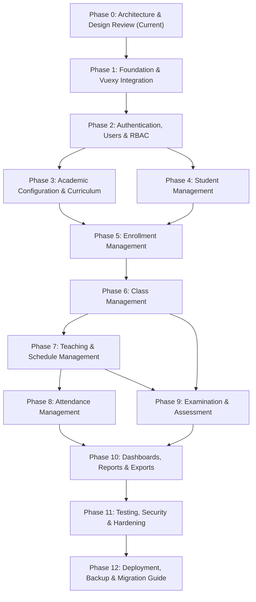

# Student Portal & Academic Management System — Development Roadmap

> **Document Status:** Complete — All Phases (0–12) Implemented & Verified  
> **Delivery Model:** Phased, Vertical-Slice Implementation (Backend + API + Permissions + Frontend + Tests + Docs per Phase)  

---

## 1. Guiding Delivery Rules

1. **No Big-Bang Generation:** Each phase is planned, built, integrated end-to-end against real APIs, tested, and verified before moving to the next phase.
2. **Definition of Done (Every Module):**
   - Django models and migrations created and applied cleanly
   - DRF serializers, filters, pagination, and ViewSets working
   - Server-side permission checks + object-level scoping enforced
   - Audit logging wired for state-changing operations
   - React/Vuexy pages connected to live APIs (zero hardcoded mock data)
   - React Hook Form + Zod validation, loading skeletons, empty states, and error handling implemented
   - Full English (`en`) and Khmer (`km`) translations added
   - Automated unit, API, and permission boundary tests passing
   - Module documentation updated
3. **Architecture Gate:** Phase 1 begins only after the user approves `docs/architecture.md`, `docs/database-design.md`, and `docs/development-roadmap.md` and confirms the Vuexy template & local toolchain.

---

## 2. Phase Dependency Overview

---

## 3. Detailed Phase Plan

### Phase 0 — Analysis & Architecture Design *(Current Milestone)*
- **Deliverables:** Workspace inspection, Vuexy readiness assessment, `docs/architecture.md`, `docs/database-design.md`, `docs/development-roadmap.md`.
- **Exit Gate:** Architecture review sign-off and resolution of open decisions in Section 4.

---

### Phase 1 — Foundation & Vuexy Template Integration
- **Prerequisites:** Architecture approval, Python 3.11+ & Node.js 20+ LTS available, Vuexy React template placed in `frontend/`.
- **Backend Deliverables:**
  - Initialize Git repository, `.gitignore`, `.env.example`, and Python virtual environment.
  - Scaffold Django project (`config/settings/{base,dev,test,prod}.py`), DRF, `drf-spectacular`, `django-filter`, `django-cors-headers`, SQLite WAL configuration.
  - Create `apps.core` (base models, pagination, standardized exception handler, health check `/api/v1/health/`).
  - Create `apps.system_settings` and `apps.auditlogs` foundations.
- **Frontend Deliverables:**
  - Inspect Vuexy template structure, dependencies, layout engine, and theming.
  - Integrate Axios API client, TanStack Query, React Hook Form + Zod, and centralized `i18next` (`en`/`km`) with Khmer font setup.
  - Wire Vertical/Horizontal layout switcher and Light/Dark theme toggle using Vuexy's native configuration.
  - Build shared SAMS UI primitives (`PageHeader`, `DataTable`, `FilterBar`, `FormModal`, `ConfirmDialog`, `StatusBadge`, `EmptyState`, `ErrorState`).
- **Exit Gate:** Backend health endpoint reachable from React SPA; Vertical/Horizontal layout switch, Light/Dark mode, and EN/KM language switch all work cleanly with zero console errors.

---

### Phase 2 — Authentication, Users, Roles & Permissions
- **Dependencies:** Phase 1.
- **Backend Deliverables:**
  - Implement `accounts.User(AbstractUser)` and auth endpoints (`/api/v1/auth/login/`, `logout/`, `token/refresh/`, `me/`, `me/preferences/`, `me/permissions/`, `password/change/`).
  - Implement User CRUD, Django Group (Role) CRUD, and Permission listing/assignment endpoints (`/api/v1/users/`, `/api/v1/roles/`, `/api/v1/permissions/`).
  - Create `seed_roles_permissions` management command for the 10 standard roles.
  - Implement `StrictDjangoModelPermissions` and audit logging for user/role/permission changes.
- **Frontend Deliverables:**
  - Login page, Change Password page, Unauthorized (`401`) and Forbidden (`403`) pages.
  - `AuthContext`, `usePermission`, `<PermissionGuard>`, `<ProtectedRoute>`, and permission-filtered vertical/horizontal navigation.
  - User Management and Role/Permission Matrix admin pages.
- **Exit Gate:** Login/logout/token-refresh lifecycle verified; unauthorized and forbidden API requests properly blocked; UI dynamically adapts to permission changes; permission boundary tests pass.

---

### Phase 3 — Academic Configuration & Curriculum
- **Dependencies:** Phase 2.
- **Backend Deliverables:**
  - `apps.academics`: `AcademicYear` (single `is_current` enforcement), `Semester`, `Degree`, `Major` (linked to `Degree`), `YearLevel`.
  - `apps.subjects`: `Subject`, `Curriculum`, `CurriculumSubject`.
  - Full DRF CRUD ViewSets, search/filters, validation rules, and audit logs.
- **Frontend Deliverables:**
  - Academic Years (with "Set as Current" action), Semesters, Degrees, Majors, Year Levels, Subjects, and Curriculum Builder pages.
  - Reusable cascading Academic Filter component (`AcademicYear -> Degree -> Major -> YearLevel -> Semester`).
- **Exit Gate:** Complete academic structure configurable end-to-end; constraint tests verify single current year, valid date bounds, and degree-major integrity.

---

### Phase 4 — Student Management
- **Dependencies:** Phase 2 (and Phase 3 optional for reference lists).
- **Backend Deliverables:**
  - `apps.students`: `Student`, `StudentCodeSequence`, `StudentGuardian`, `StudentEducationHistory`, `StudentDocument`, `StudentStatusHistory`.
  - Configurable Student ID generator service driven by `SystemSetting`.
  - Duplicate identity detection warnings, safe file upload validation for photos/documents, status transition service, CSV/Excel export, and print-profile payload endpoint.
- **Frontend Deliverables:**
  - Multi-step Student Registration form (supporting draft & completed states).
  - Student Directory with advanced filters, search, pagination, and export.
  - Student Detail Page with tabs (Profile, Guardians & Contacts, Education History, Documents, Status History, Enrollment History placeholder) + Printable Student Profile view.
- **Exit Gate:** Unique student IDs generated reliably; duplicate identity checks verified; document upload/download enforces permissions; all 7 student statuses and history tracking tested.

---

### Phase 5 — Enrollment Management
- **Dependencies:** Phases 3 & 4.
- **Backend Deliverables:**
  - `apps.enrollments`: `Enrollment`, `EnrollmentHistory`.
  - Transactional services for: New Enrollment, Re-enrollment, Batch/Individual Promotion to next Academic Year/Year Level, Major/Degree Change, and Student Transfer.
  - Business rules preventing duplicate active enrollments and preserving historical records without duplicating `Student`.
- **Frontend Deliverables:**
  - Enrollment List with academic filters and status badges.
  - New Enrollment, Re-enrollment, Promotion Wizard, and Program Change/Transfer flows.
  - Integration into Student Detail Page's Enrollment History tab.
- **Exit Gate:** Student progression across academic years preserves one permanent `Student` identity with full historical enrollment chain; duplicate enrollment constraints verified by tests.

---

### Phase 6 — Class Management
- **Dependencies:** Phase 5.
- **Backend Deliverables:**
  - `apps.classes`: `Classroom`, `ClassSection`, `ClassSubject`, `ClassMembership`, `ClassTransferHistory`.
  - Transactional student assignment service validating active enrollment matches class academic context (`AcademicYear`, `Degree`, `Major`, `YearLevel`) and capacity limits.
  - Class transfer service preserving transfer history.
- **Frontend Deliverables:**
  - Classroom Management & Class Section List pages.
  - Class Detail Page with all 7 tabs: **Overview**, **Students** (assign/transfer roster), **Subjects**, **Teachers**, **Schedule**, **Attendance**, **Reports** (latter tabs progressively wired in Phases 7–10).
- **Exit Gate:** Context mismatch and over-capacity assignments rejected with clear errors; class transfers update active membership while preserving history; API & permission tests pass.

---

### Phase 7 — Teaching & Schedule Management
- **Dependencies:** Phase 6.
- **Backend Deliverables:**
  - `apps.teachers`: `Teacher`, `TeachingAssignment`, `ClassSchedule`.
  - Conflict detection engine validating overlapping slots for Teacher, Classroom, and ClassSection (`POST /api/v1/schedules/check-conflicts/` + enforced on save).
- **Frontend Deliverables:**
  - Teacher Directory & Profile pages.
  - Teaching Assignment management (wired into Class Detail -> Teachers tab).
  - Interactive Weekly Timetable/Schedule view with live conflict alerts (wired into Class Detail -> Schedule tab).
- **Exit Gate:** Conflicting teacher, room, or class schedules are blocked both interactively and server-side; Instructor object-level scoping to assigned classes verified.

---

### Phase 8 — Attendance Management
- **Dependencies:** Phase 7.
- **Backend Deliverables:**
  - `apps.attendance`: `AttendanceSession`, `AttendanceRecord`, `AttendanceCorrectionLog`.
  - Transactional bulk attendance marking endpoint (`Present`, `Absent`, `Late`, `Excused`, `Permission`) preventing duplicate sessions/records.
  - Attendance correction workflow with mandatory reason and audit trail.
  - Attendance percentage calculator, monthly summary, and student absence warning detection (+ notification trigger).
  - Excel export and printable class attendance sheet.
- **Frontend Deliverables:**
  - Cascading Attendance Workflow (`Academic Year -> Degree -> Major -> Class -> Subject -> Date -> Load Roster -> Bulk/Individual Mark -> Save -> Summary`).
  - Attendance History, Correction modal, Warning list, and Class Detail -> Attendance tab integration.
- **Exit Gate:** Concurrent/duplicate submissions safely rejected; Instructors restricted to assigned classes; attendance percentage & warning thresholds verified by tests.

---

### Phase 9 — Examination & Assessment
- **Dependencies:** Phases 6 & 7.
- **Backend Deliverables:**
  - `apps.examinations`: `AssessmentType`, `Assessment`, `StudentScore`, `GradingScale`, `SubjectGrade`.
  - Weighted score calculation, letter grade mapping, semester/cumulative GPA computation, and grade publishing workflow.
- **Frontend Deliverables:**
  - Assessment setup per class/subject, spreadsheet-like Score Entry grid, Grade review & publication view, and Student Transcript / Academic Progress view.
- **Exit Gate:** Score bounds, weight totals, GPA calculations, and grade publication permissions verified by automated tests.

---

### Phase 10 — Dashboards, Reports, Notifications & System Settings
- **Dependencies:** Phases 8 & 9.
- **Backend Deliverables:**
  - Role-scoped real-data Dashboard APIs (Administrator, Academic Officer, Instructor, Student).
  - Complete Reporting suite (Student List, Student Profile, Enrollment by Year/Degree/Major/YearLevel/Class, Student/Class/Monthly Attendance, Student Status, Academic Progress) with CSV, Excel (`openpyxl`), and Khmer-safe PDF/Print exports.
  - `apps.notifications` inbox & read-state API.
  - Full `apps.system_settings` UI endpoints + `apps.auditlogs` filterable viewer.
- **Frontend Deliverables:**
  - Dynamic permission-routed Dashboards with Vuexy KPI cards & ApexCharts/Recharts visualizations.
  - Reports Hub with shared filter bar, preview table, Export (CSV/Excel/PDF), and Print actions.
  - Notification dropdown & center, System Settings pages, and Audit Log viewer.
- **Exit Gate:** Zero hardcoded dashboard numbers; every report filters accurately and respects user permission boundaries; Khmer text renders properly in exports and print views.

---

### Phase 11 — Testing, Security & Performance Hardening
- **Dependencies:** Phase 10.
- **Activities:**
  - Comprehensive permission matrix & IDOR security audit (verifying every endpoint across all 10 roles).
  - Query optimization audit (eliminate N+1 queries with `select_related`/`prefetch_related`, verify index usage).
  - File upload security, rate limiting, CORS/CSRF/header hardening, secret handling audit.
  - End-to-end smoke testing of core academic workflows in both Vertical/Horizontal layouts, Light/Dark themes, and English/Khmer languages.
- **Exit Gate:** Full backend test suite green with high coverage on services and permissions; frontend production build succeeds with zero TypeScript/lint errors; security checklist passed.

---

### Phase 12 — Deployment, Backup & Database Migration Strategy
- **Dependencies:** Phase 11.
- **Deliverables:**
  - Production Django settings (`config/settings/prod.py`) and environment checklist.
  - Safe SQLite online backup command (`backup_database`), UI trigger, backup history table, scheduled cron/systemd configuration, and verified restore runbook (`docs/backup-and-restore.md`).
  - Deployment guide (`docs/deployment.md`) covering Gunicorn/Uvicorn + Nginx serving static/built Vite SPA + HTTPS.
  - Documented SQLite-to-PostgreSQL migration procedure and verification script.
- **Exit Gate:** Dry-run backup and restore verified on sample database; production checklist and runbooks complete.

---

## 4. Open Questions & Decisions Required Before Phase 1

Please review and confirm the following items before we begin Phase 1 implementation:

1. **Vuexy React Template:** Where are the Vuexy template files located (or will you copy them into `frontend/` now), and which variant is it (MUI vs Reactstrap/Bootstrap, TypeScript vs JavaScript)?
2. **Local Development Environment:** Which Python version (recommend 3.11+ or 3.12+) and Node.js version (recommend 20+ LTS) should we target on your machine (e.g., Homebrew, `pyenv`, `nvm`, `conda`)?
3. **Custom `User` Model (`accounts.User(AbstractUser)`):** Confirm we should define a lightweight `AbstractUser` subclass in `apps.accounts` from Day 1 (while still using Django's native `Group` and `Permission` tables untouched) so future user fields never require breaking migrations.
4. **Enrollment Granularity:** Should students enroll once per **Academic Year** (with optional semester tracking) or separately for **each Semester**? Can a student hold two simultaneous active enrollments (dual major/degree), or strictly one active enrollment per academic year?
5. **JWT Refresh Storage:** Confirm our recommended SPA security posture — short-lived access token in memory + rotating `HttpOnly` cookie for refresh token (with blacklist on logout) — or let us know if you prefer pure header-based tokens for local/mobile simplicity.
